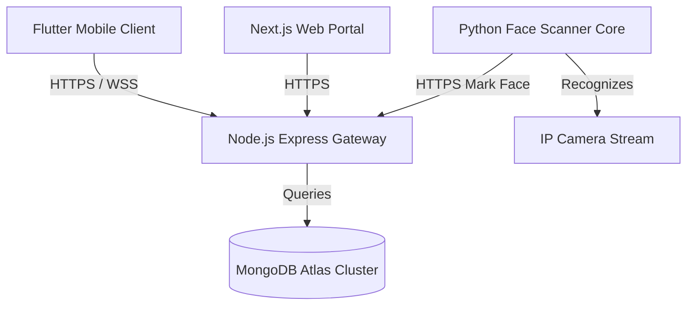

# SmartFace AI — Production Deployment Manual

This guide describes the steps required to deploy the **SmartFace AI** biometric attendance and analytics platform to a production environment.

---

## Architecture Overview



The platform is split into four primary deployment units:
1. **API Gateway / Backend**: Node.js + Express.js app serving HTTP routes and WebSocket clients.
2. **Web Application**: Next.js (React + TypeScript) single-page app serving Student, Teacher, Parent, and Admin dashboards.
3. **Face Scanner Daemon**: Python FastAPI/Core service running face verification and processing pipelines.
4. **Mobile Client**: Native Android & iOS apps compiled via Flutter.

---

## 1. Main Backend API Gateway (`backend/api`)

The main gateway is responsible for authentication, database synchronization, reporting, WebSocket dispatching, and audit logging.

### Prerequisites
- Node.js `v18.x` or higher
- PM2 (Process Manager) installed globally (`npm install -g pm2`)
- Access to a MongoDB Atlas cluster

### Installation Steps
1. Navigate to the Node directory:
   ```bash
   cd backend/api
   ```
2. Install production dependencies:
   ```bash
   npm ci --only=production
   ```
3. Copy and populate the environment file:
   ```bash
   cp .env.example .env
   ```
4. Start the server using PM2 (for clustering and auto-restarts):
   ```bash
   pm2 start src/app.js --name "smartface-api-gateway" -i max
   ```

### Health Check Endpoint
To verify gateway health, make a GET request to `/health`. Response format:
```json
{
  "status": "ok",
  "database": "connected",
  "version": "2.0.0",
  "timestamp": "2026-06-25T00:00:00.000Z"
}
```

---

## 2. Web Portal (`frontend/web`)

The Next.js web application should be deployed on **Vercel** or **AWS Amplify** for optimal caching and CDN routing.

### Vercel Deployment Instructions
1. Import the repository into Vercel.
2. In Project Settings, set the **Root Directory** to `frontend/web`.
3. Set the build commands:
   - **Build Command**: `next build`
   - **Install Command**: `npm install`
4. Add the environment variables:
   - `NEXT_PUBLIC_API_URL`: `https://api.smartface.pro` (pointing to your Node Express gateway)
5. Deploy. The static pages will automatically prerender and optimize.

---

## 3. Face Recognition Core (`backend/ai`)

The Python AI processing daemon should be deployed on an edge computer (e.g., NVIDIA Jetson, local campus server) with access to video streams or a GPU.

### Setup Instructions
1. Install Python `3.10+` and dependencies:
   ```bash
   pip install -r requirements.txt
   ```
2. Populate the `.env` file with the shared `FACE_SCANNER_TOKEN` and MongoDB Atlas URL.
3. Run the worker process or launch the FastAPI server:
   ```bash
   uvicorn src.main:app --host 0.0.0.0 --port 8000
   ```

---

## 4. Mobile App Compilation (`smartface_mobile`)

The mobile client compiles to native binaries for distribution via App Store and Google Play.

### Compilation Steps
1. Navigate to the mobile directory:
   ```bash
   cd smartface_mobile
   ```
2. Update the Environment configuration in `.env.production`:
   - `API_URL`: Gateway Endpoint (`https://api.smartface.pro`)
   - `WS_URL`: WebSocket Endpoint (`wss://api.smartface.pro`)
3. Compile the production APK/IPA binaries:
   - **Android Bundle**: `flutter build appbundle --release`
   - **iOS Archive**: `flutter build ipa --release`

---

## 5. Security Checklist

* **CORS Restrictions**: Ensure `CORS_ORIGINS` in `.env` is configured strictly to production subdomains. Wildcards (`*`) must never be used.
* **HTTPS/SSL**: Enforce HTTPS at the reverse proxy level (e.g., Nginx, Cloudflare) with HTTP-to-HTTPS redirect.
* **Secret Storage**: Ensure `.env` is added to `.gitignore` across all micro-services. Never commit secrets to the Git history.
* **Audit Logging**: Production audit entries are saved in MongoDB automatically on attendance marking, leave reviews, and dashboard logins.
