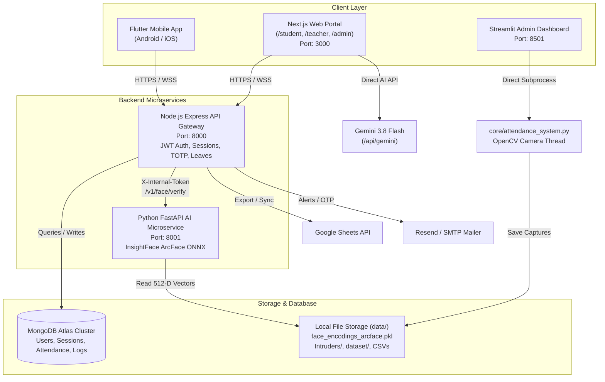

# SmartFace Attendance & Biometric Security Suite — Architecture Blueprint

This document defines the high-level architecture, module domains, network data flows, and active state of the **SmartFace** monorepo.

---

## 1. System Topology & Network Map



---

## 2. Monorepo Domain Structure

| Domain Directory | Stack / Technology | Primary Purpose | Key Entry Points |
|:---|:---|:---|:---|
| [`backend/api/`](file:///c:/Users/kalin/OneDrive/Documents/Projects/SmartFace-attendance/backend/api) | Node.js 18+, Express, Mongoose | Central business logic, JWT authentication, TOTP QR epoch rotation, attendance ledger, and WebSocket feeds. | `src/app.js` |
| [`backend/ai/`](file:///c:/Users/kalin/OneDrive/Documents/Projects/SmartFace-attendance/backend/ai) | Python 3.10+, FastAPI, ONNX Runtime | High-throughput facial embedding extraction and vector matching adapter. | `app/main.py` |
| [`frontend/web/`](file:///c:/Users/kalin/OneDrive/Documents/Projects/SmartFace-attendance/frontend/web) | Next.js 15, React 19, Tailwind, Framer Motion | Dedicated student webcam check-in (`/student`), faculty QR projector (`/teacher`), and admin sentinel (`/admin`). | `app/page.tsx` |
| [`frontend/admin/`](file:///c:/Users/kalin/OneDrive/Documents/Projects/SmartFace-attendance/frontend/admin) | Streamlit, FPDF2 | Live CCTV surveillance monitor, database record inspection, and executive Navy & Gold PDF generator. | `web_dashboard.py`, `student_report.py` |
| [`frontend/reflex/`](file:///c:/Users/kalin/OneDrive/Documents/Projects/SmartFace-attendance/frontend/reflex) | Reflex (Python-to-React) | Pure Python full-stack reactive web dashboard. | `rxconfig.py` |
| [`mobile/`](file:///c:/Users/kalin/OneDrive/Documents/Projects/SmartFace-attendance/mobile) | Flutter 3.x, Dart 3.x | Feature-first native mobile client with biometric verification, QR scanner, timetable, and offline sync. | `lib/main.dart` |
| [`core/`](file:///c:/Users/kalin/OneDrive/Documents/Projects/SmartFace-attendance/core) | OpenCV, InsightFace, Pyttsx3 | Immutability-verified computer vision engine for live camera feeds, intruder snapshot alerts, and vector training. | `attendance_system.py`, `train_faces.py` |
| [`data/`](file:///c:/Users/kalin/OneDrive/Documents/Projects/SmartFace-attendance/data) | Flat-file storage & artifacts | Binary face vector cache (`face_encodings_arcface.pkl`), image datasets, intruder snapshots, and CSV backups. | `data/` |
| [`scripts/`](file:///c:/Users/kalin/OneDrive/Documents/Projects/SmartFace-attendance/scripts) | PowerShell, Python | Unified developer CLI orchestrator (`run.ps1`), preflight health diagnostic, and database backup routines. | `run.ps1`, `exam_preflight.ps1` |
| [`docs/`](file:///c:/Users/kalin/OneDrive/Documents/Projects/SmartFace-attendance/docs) | Markdown | System specs (PRD, TRD), security audit findings, certification manifests, and deployment runbooks. | `docs/` |

---

## 3. Data Flow & Security Protocols

### A. Dynamic Anti-Proxy QR Rotation
1. **Teacher Podium** initiates session at `POST /sessions/start`. Node.js generates a rotating TOTP token (15-second epoch).
2. **Classroom Projector** displays the live QR code on smartboard (`/teacher`).
3. **Student Device** scans the code via mobile camera or webcam (`/student`).
4. **API Gateway** validates the token within a configurable 30-second clock-drift window before marking presence.

### B. Live ArcFace Face Verification
1. Client captures frame and sends multipart image to Node.js `POST /attendance/mark/face` or directly to Python AI `POST /v1/face/verify`.
2. Python AI passes image through InsightFace (`buffalo_l`) ONNX model, extracting a normalized 512-dimensional vector.
3. Vector is compared against enrolled embeddings in memory using cosine similarity (threshold $\ge 0.60$).
4. Successful match triggers automated audio cue ("Welcome, [Name]!") and updates the student's attendance record in MongoDB.
5. Unknown visitors lingering $>5$ seconds trigger snapshot capture in `data/Intruders/` and instant SMTP intruder alert.

---

## 4. Master Developer Commands

The suite can be controlled via single-line commands using `Makefile`, `npm`, or `scripts/run.ps1`:

```bash
# Start full local stack (Node 8000 + Python AI 8001 + Next.js 3000)
npm run dev          # or: make dev / .\scripts\run.ps1 dev

# Start backend services only
npm run backend      # or: make backend / .\scripts\run.ps1 backend

# Start modern web client
npm run web          # or: make web

# Start Streamlit admin monitor
npm run admin        # or: make admin

# Run system health diagnostics
npm run preflight    # or: make preflight

# Gracefully terminate background microservices
npm run stop         # or: make stop

# Clean temporary bytecode, caches, and build debris
npm run clean        # or: make clean
```
