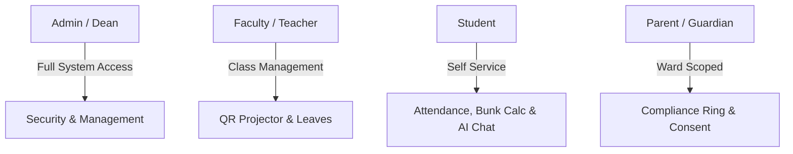
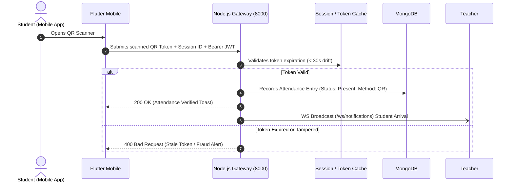
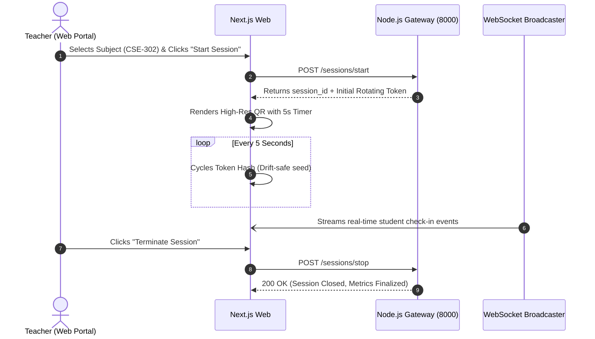

# 📄 Product Requirements Document (PRD)
## SmartFace AI — Next-Gen Biometric Attendance & Security Suite

---

| Document Metadata | Details |
|:---|:---|
| **Product Name** | SmartFace Attendance & Biometric Security Platform |
| **Document Version** | `v2.4.0` (Production Master) |
| **Status** | Approved / Active Specification |
| **Target Audience** | Engineering, QA, Product Management, Institutional Stakeholders |
| **Author** | Advanced Agentic Engineering Team |
| **Last Updated** | September 2026 |

---

## 📑 Table of Contents
1. [Executive Summary & Problem Statement](#1-executive-summary--problem-statement)
2. [Product Vision & Core Value Propositions](#2-product-vision--core-value-propositions)
3. [User Personas & Role-Based Access Control (RBAC)](#3-user-personas--role-based-access-control-rbac)
4. [Feature Epics & Functional Requirements](#4-feature-epics--functional-requirements)
   - [Epic 1: Identity, Authentication & Profile Studio](#epic-1-identity-authentication--profile-studio)
   - [Epic 2: Biometric Verification & Anti-Proxy QR Shield](#epic-2-biometric-verification--anti-proxy-qr-shield)
   - [Epic 3: Student Academic Dashboard & Bunk Planner](#epic-3-student-academic-dashboard--bunk-planner)
   - [Epic 4: Faculty Session Orchestrator & Live Feed](#epic-4-faculty-session-orchestrator--live-feed)
   - [Epic 5: Parent / Guardian Dependent Watch Portal](#epic-5-parent--guardian-dependent-watch-portal)
   - [Epic 6: Institutional Leave Management & Consent](#epic-6-institutional-leave-management--consent)
   - [Epic 7: Conversational AI Academic Analyst Hub](#epic-7-conversational-ai-academic-analyst-hub)
   - [Epic 8: Analytics, Heatmaps & Audit Reporting](#epic-8-analytics-heatmaps--audit-reporting)
5. [User Journeys & Workflow Diagrams](#5-user-journeys--workflow-diagrams)
6. [Non-Functional Requirements (NFRs)](#6-non-functional-requirements-nfrs)
7. [Success Metrics & Key Performance Indicators (KPIs)](#7-success-metrics--key-performance-indicators-kpis)
8. [Release Milestones & Future Scope](#8-release-milestones--future-scope)

---

## 1. Executive Summary & Problem Statement

### The Problem
Traditional academic and enterprise attendance systems suffer from severe vulnerabilities:
1. **Buddy Punching & Proxy Attendance:** Manual sign-in sheets, paper roll calls, and static barcode/RFID cards are routinely abused, resulting in 15%–25% fraudulent attendance.
2. **Administrative Overhead:** Teachers spend up to 10–15 minutes per lecture taking manual roll call, reducing instructional time.
3. **Delayed Parental Awareness:** Guardians are typically notified of chronic absenteeism weeks after attendance drops below legal or academic accreditation thresholds.
4. **Disjointed Ecosystems:** Colleges maintain disparate systems for attendance, leave requests, timetables, and security cameras, causing synchronization bottlenecks.

### The Solution
**SmartFace AI** delivers an integrated, multi-platform biometric attendance and surveillance ecosystem. Combining high-speed deep learning facial recognition (**ArcFace 512-D** via ONNX runtime) with **dynamic rotating anti-proxy QR codes**, real-time **WebSocket telemetry**, and an **LLM-powered academic analyst**, SmartFace provides touchless, tamper-resistant, and instantaneous attendance management across Web, Desktop, and Mobile clients.

---

## 2. Product Vision & Core Value Propositions

* **Zero-Proxy Guarantee:** Dynamic time-synchronized QR codes cycling every 5–15 seconds combined with on-device facial recognition prevent remote attendance fraud.
* **Instantaneous Verification:** Sub-second recognition latency ($< 350\text{ ms}$) even with multi-face detection in crowded lecture halls.
* **Proactive Student Retention:** Real-time risk modeling highlights students dipping below the 75% attendance boundary, alerting parents, advisors, and faculty proactively.
* **Universal Accessibility:** Seamless operation across modern web browsers (Next.js 15), mobile devices (Flutter iOS/Android), and standalone administrative kiosks (Streamlit).

---

## 3. User Personas & Role-Based Access Control (RBAC)

### 3.1 Persona Profiles

| Role | Primary User Persona | Primary Goals & Core Workflows |
|:---|:---|:---|
| **Student** | Alice (Undergraduate, CS) | Check into class via QR/face in $< 3$ seconds, track attendance streak, plan safe absences with Bunk Simulator, apply for medical leave, and consult AI Chatbot. |
| **Faculty / Teacher** | Dr. Miller (Professor) | Launch lecture attendance sessions, project rotating anti-proxy QR code, monitor live arrivals on WebSocket feed, review student leaves, and enroll student faces. |
| **Parent / Guardian** | Robert (Parent of 2 wards) | Switch between enrolled children, monitor daily check-in timestamps, receive absence SMS/toasts, and digitally sign parental consent for leave requests. |
| **Administrator / Dean** | Dean Evans (HOD / Security Admin) | Oversee department-wide compliance, view live camera intruder alerts, inspect immutable biometric audit logs, and export institutional PDF/Excel reports. |

### 3.2 Permission Matrix

| Feature / Domain | Student | Faculty / Teacher | Parent | Administrator |
|:---|:---:|:---:|:---:|:---:|
| Self Attendance Mark (QR / Face) | ✅ | ❌ | ❌ | ❌ |
| Start / Stop Attendance Session | ❌ | ✅ | ❌ | ✅ |
| Generate Rotating QR Projector | ❌ | ✅ | ❌ | ✅ |
| View Personal Attendance & Timetable | ✅ | ❌ | ❌ | ✅ |
| View Linked Ward Attendance Roster | ❌ | ❌ | ✅ | ✅ |
| Submit Leave Application | ✅ | ❌ | ❌ | ❌ |
| Approve / Reject Leave Requests | ❌ | ✅ | ❌ | ✅ |
| Sign Parental Leave Consent | ❌ | ❌ | ✅ | ❌ |
| Biometric Face Studio & Embedding Retrain | ❌ | ✅ | ❌ | ✅ |
| Intruder Surveillance & CCTV Snapshots | ❌ | ❌ | ❌ | ✅ |
| System Health & Latency Telemetry | ❌ | ✅ (Limited) | ❌ | ✅ (Full) |
| Department Analytics & CSV/PDF Export | ❌ | ✅ (Class) | ❌ | ✅ (Global) |

---

## 4. Feature Epics & Functional Requirements

### Epic 1: Identity, Authentication & Profile Studio
* **REQ-1.1:** Support registration and login via Email + Bcrypt password with 24-hour JSON Web Tokens (JWT).
* **REQ-1.2:** Transactional One-Time Password (OTP) verification for secure login and self-service password resets.
* **REQ-1.3:** Single Sign-On (SSO) integration via Google OAuth2 with automatic institutional domain whitelisting.
* **REQ-1.4 (Universal Profile Studio):** Every user can manage personal contact details, view their assigned role badge, and upload a portrait avatar.
* **REQ-1.5 (Session Security):** Multi-device tracking with per-session token identifiers, allowing users to revoke individual logins or trigger a "Logout All Other Devices" command.

### Epic 2: Biometric Verification & Anti-Proxy QR Shield
* **REQ-2.1 (ArcFace AI Face Engine):** Ingest student portrait images, extract 512-dimensional vector embeddings, and achieve $\ge 99.2\%$ verification accuracy with cosine similarity threshold $\ge 0.68$.
* **REQ-2.2 (Dynamic Anti-Proxy QR):** Server generates time-synchronized token hashes rotating every 5–15 seconds. Scanned tokens older than 30 seconds must be strictly rejected.
* **REQ-2.3 (Geofence Validation):** Configurable GPS latitude/longitude bounding radius (e.g. 50 meters) preventing off-campus check-ins.
* **REQ-2.4 (Active Intruder Capture):** Unregistered hovering faces detected in active camera streams trigger instant snapshot capture, persistent storage in `data/Intruders/`, and WebSocket/SMTP security alerts.

### Epic 3: Student Academic Dashboard & Bunk Planner
* **REQ-3.1 (Compliance HUD):** Animated SVG radial attendance ring indicating semester percentage, categorized as *Elite* ($\ge 85\%$), *Good* ($75\%–84\%$), or *At Risk* ($< 75\%$).
* **REQ-3.2 (Streak Counter):** Consecutively attended class day counter with fire gamification badges.
* **REQ-3.3 (Subject-Wise Progress):** Breakdown of all registered semester subjects showing attended classes, total classes, and individual percentage progress bars.
* **REQ-3.4 (AI Bunk & Compliance Calculator):** Interactive slider-driven simulator calculating:
  * Safe Bunk Allowance: $\lfloor (\text{Present} - \text{Target} \times \text{Total}) / \text{Target} \rfloor$
  * Catch-Up Requirement: $\lceil (\text{Target} \times \text{Total} - \text{Present}) / (1 - \text{Target}) \rceil$
* **REQ-3.5 (Lecture Timetable):** Weekly interactive class schedule with search, day selector tabs, and direct "Check In" shortcuts.

### Epic 4: Faculty Session Orchestrator & Live Feed
* **REQ-4.1 (Session Setup):** Teacher launches class sessions by selecting Course Subject, Duration (minutes), and Geofence distance.
* **REQ-4.2 (Projector Mode):** High-contrast dynamic QR projection window with laser sweep animations designed for classroom overhead projectors.
* **REQ-4.3 (Real-Time Arrival Feed):** Bi-directional WebSocket stream (`/ws/notifications`) rendering live check-in cards as students scan into class.
* **REQ-4.4 (Face Studio):** Integrated camera tool for professors to enroll new students and trigger background model retraining without server downtime.

### Epic 5: Parent / Guardian Dependent Watch Portal
* **REQ-5.1 (Multi-Ward Selector):** Parents with multiple children can switch seamlessly between dependent profiles.
* **REQ-5.2 (Daily Activity Ledger):** Chronological log of student check-in timestamps, subject titles, and verification modes (QR vs. Face).
* **REQ-5.3 (Absence Alerts):** Automatic warning badges and notification dispatches if a student fails to check in by scheduled start times.
* **REQ-5.4 (Guardian Leave Endorsement):** Interactive mechanism for parents to review and digitally endorse their child's absence requests.

### Epic 6: Institutional Leave Management & Consent
* **REQ-6.1 (Application Submission):** Students submit leave requests under categories: *Sick Leave*, *Casual Leave*, *Medical Leave*, or *Academic Duty*.
* **REQ-6.2 (Quota Tracking):** Automatic deduction from annual allowances (10 Sick, 15 Personal, 5 Emergency, 12 Academic).
* **REQ-6.3 (Approval Workflow):** Teachers/Admins receive pending leave cards with options to Approve or Reject with audit remarks.

### Epic 7: Conversational AI Academic Analyst Hub
* **REQ-7.1 (Dual LLM Engine):** Integrated with Google Gemini (Flash 1.5) and Groq Cloud (Llama-3-70B) for natural language reasoning.
* **REQ-7.2 (Context Injection):** Injects user attendance records, timetable, and leave balances into the LLM system prompt.
* **REQ-7.3 (Prompt Injection Defense):** Server-side sanitization filtering prompt injection payloads, system override attempts, and NoSQL injection keys.

### Epic 8: Analytics, Heatmaps & Audit Reporting
* **REQ-8.1 (16-Week Heatmap):** Semester-wide density matrix visualizing check-in intensity across weeks.
* **REQ-8.2 (Multi-Format Export):** Instant downloads in CSV, Excel, and JSON formats.
* **REQ-8.3 (Executive PDF Reports):** Generates Deep Navy & Gold styled formal attendance certificates with cryptographic verification QR codes.

---

## 5. User Journeys & Workflow Diagrams

### 5.1 Student Dynamic QR Check-in Flow

### 5.2 Teacher Class Session & Dynamic QR Projection Flow

---

## 6. Non-Functional Requirements (NFRs)

### 6.1 Performance & Latency Targets
* **Facial Verification Latency:** 512-D embedding extraction and cosine match must complete in $\le 450\text{ ms}$ on standard CPU hardware ($\le 150\text{ ms}$ on GPU).
* **QR Validation Latency:** Token decryption and database insertion must respond in $\le 100\text{ ms}$.
* **Page Load Time:** Next.js First Contentful Paint (FCP) $\le 1.2\text{ s}$ on 4G networks; shared bundle size $< 110\text{ kB}$.

### 6.2 Security & Compliance Standards
* **OWASP Top 10 Compliance:** Strict parameterized queries via Mongoose ODM, eliminating NoSQL injection.
* **Media Upload Hygiene:** All avatars processed via `sharp`, re-encoded to WebP at $400\times 400$, stripped of EXIF tags, and assigned UUID filenames.
* **HTTP Hardening:** Enforced Helmet headers (`nosniff`, `X-Frame-Options: DENY`, `Content-Security-Policy`).

### 6.3 Reliability & Offline Resilience
* **Network Interruption Tolerance:** Mobile app stores scanned attendance in local encrypted storage and automatically flushes records when connectivity returns.
* **Service Uptime Target:** $99.9\%$ SLA for API Gateway and AI microservice.

---

## 7. Success Metrics & Key Performance Indicators (KPIs)

| Metric Category | Target KPI | Measurement Method |
|:---|:---|:---|
| **Biometric Accuracy** | $\ge 99.2\%$ True Positive Rate | Validation against 500+ student facial benchmark sets |
| **Proxy Prevention** | $0\%$ Proxy Acceptance | Time-drift token rejection tests ($> 30\text{s}$ rejection) |
| **Roll-Call Time Savings** | $90\%$ reduction | From 12 mins/class manual to $< 45\text{s}$ automated |
| **Parent Engagement** | $\ge 80\%$ parent login rate | Monthly active guardians checking dependent logs |
| **API Response P95** | $\le 180\text{ ms}$ | Production telemetry monitoring via `/health` pings |

---

## 8. Release Milestones & Future Scope

* **v2.4 (Current Master):** Unified Node.js API Gateway, Next.js Web Portal, Flutter Mobile Client, ArcFace ONNX Microservice, Offline Sync Queue.
* **v2.5 (Upcoming):** Direct edge face verification on mobile neural chips (CoreML / TFLite) without round-tripping video frames to server.
* **v3.0 (Future Vision):** Multi-campus federation with automated gate turnstile integration and RFID backup failover.
