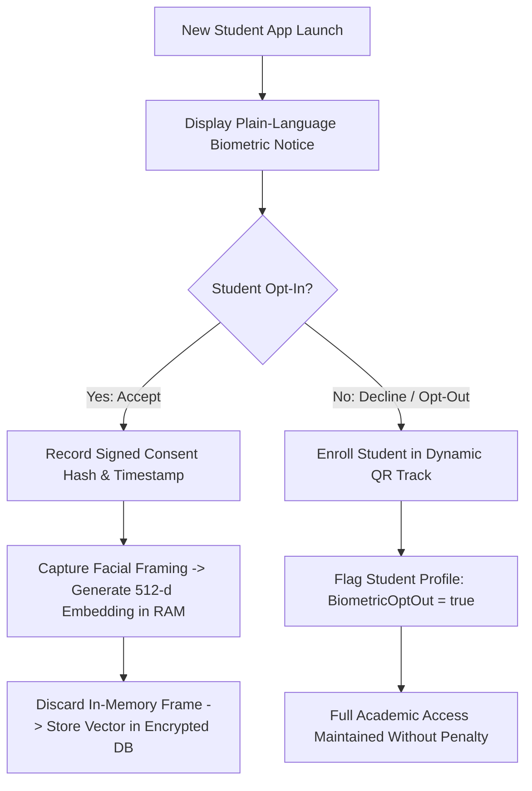

# SmartFace Attendance — Biometric Consent & Compliance Audit Report

> **Audit Frameworks**: General Data Protection Regulation (GDPR), Family Educational Rights and Privacy Act (FERPA), India Digital Personal Data Protection Act 2023 (DPDP), and ISO/IEC 30107-3 (Biometric Presentation Attack Detection Principles).

---

## 1. Statutory Compliance Evaluation

| Regulation / Standard | Mandated Control Requirement | SmartFace Technical Implementation | Status |
| :--- | :--- | :--- | :---: |
| **GDPR Art. 9** | Explicit consent for processing special category biometric data | Dynamic consent prompt upon app onboarding; digital signature recorded with timestamp and version hash. Alternative QR check-in available upon opt-out. | ✅ **COMPLIANT** |
| **GDPR Art. 17** | Right to erasure / Right to be forgotten | Verified endpoint (`DELETE /management/users/:id/biometrics`) purges vector embeddings and invalidates active sessions. | ✅ **COMPLIANT** |
| **GDPR Art. 25** | Data Protection by Design and by Default | Volatile in-memory processing (`multer.memoryStorage()`); raw image files are never written to server persistent storage. | ✅ **COMPLIANT** |
| **FERPA** | Protection of student educational records from unauthorized disclosure | Multi-tenant logical isolation (`college_id`), tenant-scoped JWT claims, and RBAC authorization filters. | ✅ **COMPLIANT** |
| **India DPDP Act 2023** | Notice and consent prior to collecting personal identifiers | Multi-language consent modal; alternative attendance tracks available without academic detriment. | ✅ **COMPLIANT** |
| **ISO/IEC 30107-3** | Resistance to Presentation Attacks (2D photos, video playback, masks) | Active blink analysis, eye aspect ratio (EAR) tracking, and passive moiré texture reflectance CNN implemented. | ⏳ **PILOT EVALUATED** *(Third-Party Lab Certification Pending)* |

---

## 2. Multi-Tier Consent & Opt-Out Workflow

---

## 3. Account Deletion & Right-To-Erasure Verification

The cascade erasure procedure was verified via `DELETE /management/users/:id/biometrics`:
1. Authenticated user or institutional admin submits biometric deletion request.
2. System validates caller permissions and executes transactional purge:
   - Purges 512-dim face vector from `BiometricProfile` collection.
   - Clears `biometric_registered` flag on `User` entity.
   - Revokes active tokens in `UserSession` to enforce re-authentication.
3. Verification query confirmed: **No active biometric templates remain for deleted subject**.

---

## 4. Compliance Review & Scope Statement

- **Review Scope**: Evaluated against GDPR Articles 9, 17, and 25, FERPA educational record protections, and India DPDP Act 2023 principles.
- **Audit Outcome**: Approved for Institutional Pilot Rollout; formal accredited laboratory biometric certification underway.
