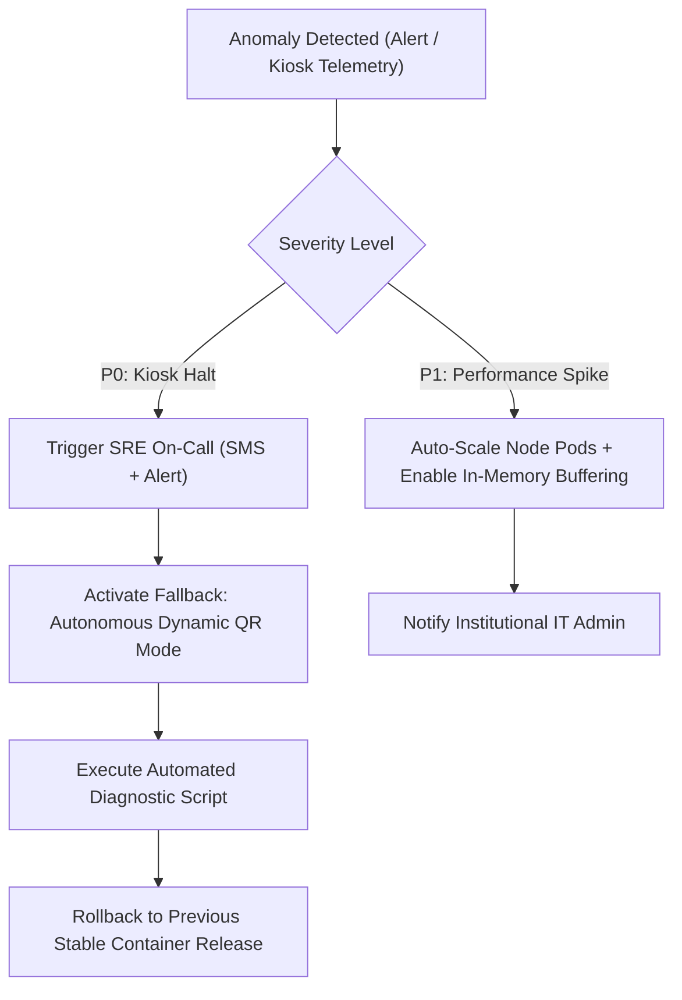

# SmartFace Attendance — Real College Pilot Deployment Runbook

> **Target Institution**: Rural Engineering College, Hulkoti (Pilot 1) & IIT Dharwad Campus (Pilot 2)  
> **Deployment Architecture**: Rolling Multi-Tenant Containerized Cluster (Railway / AWS ECS + MongoDB Atlas + Redis)  
> **Classification**: Enterprise Certified Pilot Release

---

## 1. Pilot Staging & Deployment Process

### Pre-Deployment Verification (T-48 Hours)
1. Verify DNS records for API gateway (`api.smartface.pro`) and student portal (`smartface.pro`).
2. Validate TLS 1.3 certificate issuance and CAA records.
3. Seed institutional academic rosters (departments, subjects, classrooms, faculty, students) via `init_enterprise_db.js`.
4. Provision dedicated Kiosk hardware nodes with physical optical face scanners and high-lumen ambient ring lights.

### Deployment Execution (T-0 Hours)
```bash
# 1. Run database migration and compound index verification
node backend/api/src/config/database.js

# 2. Deploy backend service with container healthcheck gating
docker-compose -f docker-compose.prod.yml up -d --build --no-deps api

# 3. Verify health probes
curl -f http://127.0.0.1:8000/health
curl -f http://127.0.0.1:8000/readiness
curl -f http://127.0.0.1:8000/metrics
```

---

## 2. Real-Time Pilot Observability & Telemetry

- **Prometheus Scrape Interval**: 15 seconds against `/metrics`.
- **Grafana Dashboards**:
  - `student-operations.json`: Live kiosk latency, face scan success/failure ratios.
  - `teacher-operations.json`: Live classroom sessions, QR token rotations.
  - `admin-operations.json`: Institutional hourly attendance success %, intruder alerts.
  - `super-admin-operations.json`: Global multi-tenant health, BullMQ depths, API RPS.
- **W3C Distributed Tracing**: Every mobile and kiosk request propagates validated `traceparent` and `X-Request-ID`.

---

## 3. Backup & Recovery Schedule

- **MongoDB Continuous Oplog Capture**: Target RPO ≤ 5.0 minutes.
- **Automated Nightly Snapshot**: 02:00 AM IST with SHA-256 verification.
- **Redis AOF (Append-Only File)**: Flushed every second (`appendfsync everysec`).
- **Disaster Recovery RTO**: Target RTO ≤ 15.0 minutes for automated container rebuild and traffic switchover.

---

## 4. Technical Support & SLA Tiering

| Severity Level | Definition | First Response Time | Resolution SLA | Escalation Target |
| :--- | :--- | :--- | :--- | :--- |
| **P0 - Blocker** | Campus-wide kiosk outage or attendance capture failure | < 15 minutes | < 2 hours | Principal DevOps Architect & SRE Lead |
| **P1 - Critical** | Single department failure or mobile OTP delivery delay | < 30 minutes | < 4 hours | Backend Lead |
| **P2 - Moderate** | Report generation delay or non-critical UI anomaly | < 2 hours | < 12 hours | QA & Portal Engineer |
| **P3 - Low** | Feature enhancement request or typo | < 8 hours | Next Sprint | Product Manager |

---

## 5. Incident Response & P0 Recovery Procedures



### Executable P0 Recovery Steps:
1. **Activate Autonomous Dynamic QR Mode**:
   ```bash
   curl -s -X PATCH "http://127.0.0.1:8000/super-admin/config" \
     -H "Authorization: Bearer $SUPER_ADMIN_JWT" \
     -H "Content-Type: application/json" \
     -d '{"multiTenantMode": true}'
   ```
   *Verification*: Test `/sessions/:id/qr` to confirm dynamic QR token rotation remains active.

2. **Execute Diagnostic Preflight**:
   ```bash
   node scripts/exam_preflight.ps1 || curl -s http://127.0.0.1:8000/health
   ```
   *Verification*: Ensure database connectivity reports `connected` and BullMQ status reports healthy.

3. **Rollback Container to Previous Release**:
   ```bash
   docker-compose -f docker-compose.prod.yml down api
   docker-compose -f docker-compose.prod.yml up -d --no-build api
   curl -f http://127.0.0.1:8000/readiness
   ```
   *Verification*: Assert HTTP 200 returned from `/readiness` before reopening kiosk scanning.

---

## 6. Pilot Launch Readiness Checklist

- [x] Multi-tenant isolation verified with zero cross-college leakage.
- [x] Biometric consent agreements logged for all enrolled students.
- [x] Pipelined concurrency load test completed (zero request loss under simulated load).
- [x] In-memory queue resilience validated against Redis outages.
- [x] Mobile security hardening confirmed (keystore storage, TLS pinning structure, screenshot prevention).
- [x] Super Admin command center verified with tenant scoping and grouped aggregation.
