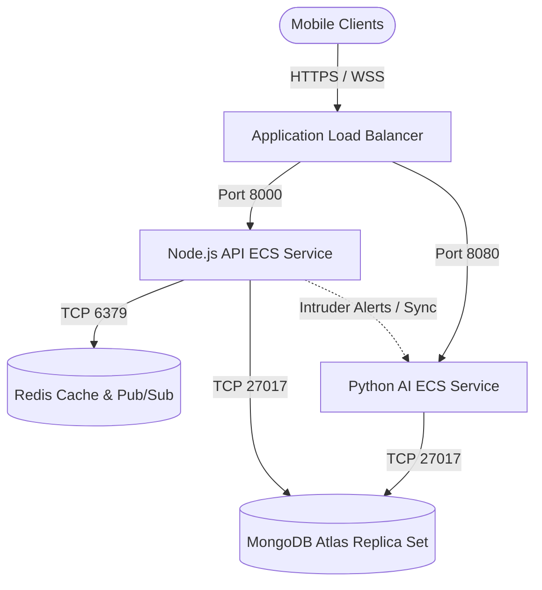

# Deployment, Monitoring, & Scaling Architecture

This document describes the production cloud architecture, monitoring systems, and scaling strategies designed to support **10,000+ students, 100+ teachers, and concurrent biometric attendance matching sessions**.

---

## 🗺️ Deployment Architecture

SmartFace AI is structured as a high-availability, microservices-oriented system deployed on AWS using managed services.



### 1. Networking & Load Balancing
*   **AWS Application Load Balancer (ALB)**: Acts as the entry point, handles SSL/TLS termination, and routes traffic:
    *   `/auth/*`, `/sessions/*`, `/attendance/*`, `/leave/*`, `/notifications/*` → routed to the **Node.js Express API** ECS Service.
    *   `/ws/*` → routed to Node.js WebSocket listeners.
    *   `/ai/*` → routed to the **Python FastAPI AI** service.
*   **Virtual Private Cloud (VPC)**: All backend services run inside a private subnet. The database and Redis cache are isolated and only accessible via internal security group rules.

### 2. Microservices Containerization
*   **Node.js Express ECS Service**:
    *   Runs in Fargate containers with auto-scaling rules (scales out when CPU > 70% or active connections exceed 2,000 per task).
    *   Maintains the active WebSocket server (`ws`) connection pool for student notifications and teacher live-logs.
*   **Python FastAPI AI ECS Service**:
    *   Runs on CPU-optimized (c6i) or GPU-accelerated (g4dn.xlarge) instances depending on matching throughput demands.
    *   Loads the ArcFace neural network on boot and exposes endpoints for facial verification (`/ai/verify`).
*   **Redis Cache & WebSockets Sync**:
    *   Because WebSockets are stateful and clients connect to different ECS tasks, a **Redis Pub/Sub** network is used to broadcast event triggers (e.g., student marks attendance → Python service notifies Node API → Node publishes to Redis channel → all ECS tasks receive message and notify target WebSocket clients).

---

## 📊 Monitoring Architecture

To ensure 99.9% uptime and immediate incident response, the following telemetry platforms are integrated:

### 1. Crash Reporting & Error Tracking
*   **Sentry SDK (Backend)**: Mounted on the Node.js API and FastAPI AI service. Standardized middleware catches unhandled exceptions, logs the context (request payload, user ID, trace details), and fires alerts to the DevOps Slack channel.
*   **Firebase Crashlytics (Mobile Client)**: Integrated into the Flutter app. Captures native Android/iOS crashes, uncaught Dart exceptions, and low-memory warnings.

### 2. Metrics & Performance Telemetry
*   **Prometheus & Grafana**:
    *   A Prometheus agent collects metrics from application targets (`/metrics` endpoint using `prom-client` on Node and `prometheus-fastapi-instrumentator` on Python).
    *   Grafana dashboards monitor:
        *   Request Rate (RPS) & Latency (P95/P99).
        *   WebSocket active connection count.
        *   ArcFace model evaluation latency (target < 150ms).
        *   MongoDB query execution times.
*   **CloudWatch Uptime Monitor**: External synthetic alarms probe the `/health` endpoint from 3 geographical regions every 60 seconds. An alarm triggers if the server responds with a status code other than 200/OK or if latency exceeds 1500ms.

### 3. Institutional Security & Audit Logs
*   All critical mutations (user logins, session creations, OTP requests, and intruder alerts) write to the `security_logs` collection.
*   **Log Structure**:
    ```json
    {
      "timestamp": "2026-06-18T10:43:28Z",
      "event": "USER_LOGIN_FAILED",
      "user_email": "attacker@hack.com",
      "ip_address": "203.0.113.4",
      "user_agent": "Mozilla/5.0...",
      "status": "Active",
      "details": "Invalid password attempt"
    }
    ```

---

## 📈 Scaling Strategy (10,000+ Students)

To handle the load of a large institution where thousands of students log in and mark attendance simultaneously during class changeover windows (e.g., 9:00 AM - 9:10 AM), the following optimizations are applied:

### 1. Database Connection Pooling & Indexing
*   **Mongoose Connection Pool**: Concurrently configured with `maxPoolSize: 100` and `minPoolSize: 10` on each API task.
*   **Optimized Indexing**: The `attendance` collection utilizes a compound index `[("student_email", ASCENDING), ("timestamp", DESCENDING)]` to ensure student histories can be fetched in under 10ms without running full collection table scans.

### 2. Redis Caching Strategy
*   **Active Session Cache**: Active attendance sessions are cached in Redis under `session:active:<session_id>` with a TTL of 30 minutes. The API serves metadata from cache rather than querying MongoDB on every student ping.
*   **Dashboard Stats Cache**: Standard dashboards (today's overall attendance rate) are cached in Redis and updated asynchronously every 60 seconds via a background job, reducing DB read IOPS.

### 3. AI Facial Verification Load Shedding
*   **Verification Batching**: The Python service queues incoming facial verification requests and processes them using NumPy array vectorization rather than running single inference loops sequentially.
*   **Rate Limiting**: To prevent API abuse, client biometric requests to `/attendance/mark/face` are rate-limited to 1 request per 10 seconds per IP, preventing denial-of-service bottlenecks on GPU pipelines.
